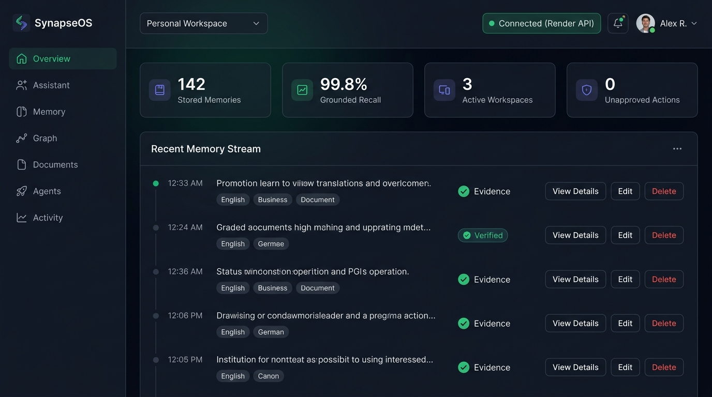
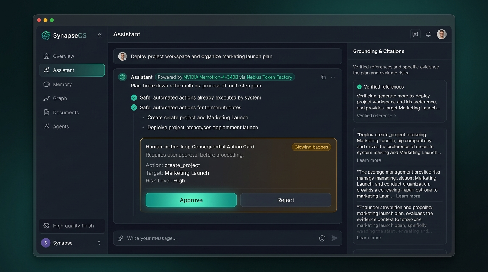
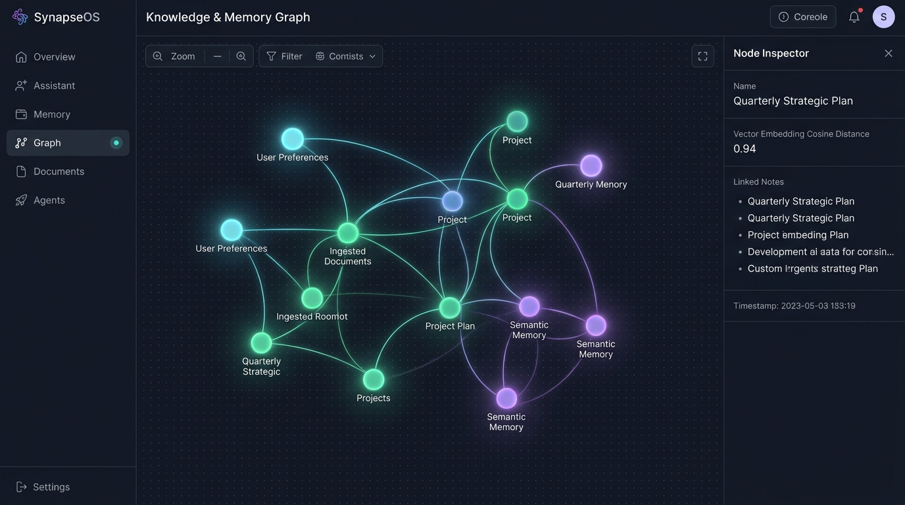
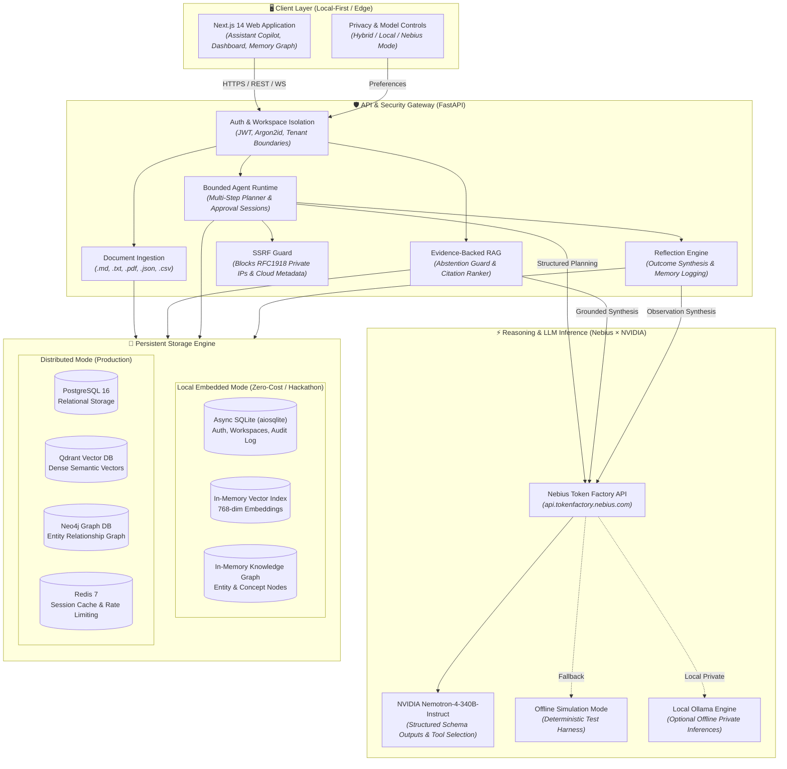

# SynapseOS — Privacy-First Personal AI Operating System

<p align="center">
  <strong>An AI That Remembers, Reasons, and Acts — While Keeping You in Full Control</strong>
</p>

<p align="center">
  <a href="https://synapseos-three.vercel.app"></a>
  <a href="https://synapseos-api-2onj.onrender.com/docs"></a>
  <a href="https://synapseos-api-2onj.onrender.com/health"></a>
  <a href="LICENSE"></a>
</p>

<p align="center">
  
  
  
  
  
  
</p>

---

## 🌐 Live Deployments & Quick Links

| Service | Platform | URL | Status |
| :--- | :--- | :--- | :--- |
| **Frontend Web App** | **Vercel** | [https://synapseos-three.vercel.app](https://synapseos-three.vercel.app) |  |
| **Backend API** | **Render** | [https://synapseos-api-2onj.onrender.com](https://synapseos-api-2onj.onrender.com) |  |
| **Interactive API Docs** | **Swagger / OpenAPI** | [https://synapseos-api-2onj.onrender.com/docs](https://synapseos-api-2onj.onrender.com/docs) |  |
| **Live Health Probe** | **Render Health Check** | [https://synapseos-api-2onj.onrender.com/health](https://synapseos-api-2onj.onrender.com/health) |  |
| **Readiness Probe** | **Render Readiness Check**| [https://synapseos-api-2onj.onrender.com/health/ready](https://synapseos-api-2onj.onrender.com/health/ready) |  |

> **Note on Free-Tier Hosting**: Render's free instances spin down when idle. If accessing the API or docs after inactivity, please allow **30–45 seconds** for cold boot.

---

## 📸 Application Showcase

### 1. System Dashboard & Persistent Memory Stream
Unified overview of your personal AI operating system featuring stored memories, grounded recall rate, active workspace management, and real-time evidence verification badges.
<p align="center">
  
</p>

### 2. Assistant Copilot & Human-in-the-Loop Consequential Gate
Conversational reasoning driven by **NVIDIA Nemotron-4-340B via Nebius Token Factory**. Consequential tools (e.g., project modifications, file alterations) pause automatically and render an interactive security approval gate for explicit human authorization before execution.
<p align="center">
  
</p>

### 3. Interactive Knowledge & Memory Graph
Visual exploration of interconnected knowledge nodes, entity associations, semantic memory clusters, and document references with real-time cosine similarity and node inspection.
<p align="center">
  
</p>

---

## 💡 Vision & Core Value Proposition

Modern cloud assistants lock your personal notes and enterprise knowledge into opaque silos, suffer from ungrounded hallucinations, and execute opaque actions without authorization. 

**SynapseOS** solves this by establishing a dependable, local-first personal AI operating system centered on **three foundational pillars**:

1. **Persistent Multi-Modal Memory**: Relational, semantic (vector), and knowledge-graph representations of notes, files, and interactions with strict tenant/workspace isolation and verifiable CRUD transparency.
2. **Evidence-Backed RAG with Abstention Guard**: All answers are grounded in retrieved source chunks with verifiable citations. When evidence is insufficient, SynapseOS strictly abstains from hallucinating facts.
3. **Bounded Agent Runtime with Human Approval Gates**: Structured planning via **NVIDIA Nemotron-4-340B** decomposed into discrete steps. Consequential actions require explicit human confirmation, while SSRF guards block private network and metadata probing.

---

## 🏗️ System Architecture



---

## 🔁 The Memory-to-Action Execution Loop

SynapseOS enforces a strictly bounded execution pipeline that guarantees transparency and safety:

```
┌─────────────────┐       ┌─────────────────┐       ┌─────────────────┐
│   User Prompt   │ ───►  │ Grounded Memory │ ───►  │ Nemotron Multi- │
│  & Intent Input │       │ Semantic Search │       │   Step Planner  │
└─────────────────┘       └─────────────────┘       └────────┬────────┘
                                                             │
                                                             ▼
┌─────────────────┐       ┌─────────────────┐       ┌─────────────────┐
│ Post-Execution  │ ◄───  │ Safe Auto-Exec  │ ◄───  │  Consequential  │
│ Reflection Log  │       │  & SSRF Filters │       │  Approval Gate  │
└─────────────────┘       └─────────────────┘       └─────────────────┘
```

1. **Intent & Retrieval**: The user issues a goal (e.g., *"Create project Mobile Launch and analyze offline embeddings"*). Semantic memories and graph edges are retrieved within strict workspace boundaries.
2. **Structured Plan Generation**: NVIDIA Nemotron-4-340B decomposes the request into an execution plan with typed arguments and predicted impacts.
3. **Safety Evaluation**:
   - **Safe Tools** (e.g., `search_knowledge`, `retrieve_context`) execute autonomously.
   - **Consequential Tools** (e.g., `create_project`, `modify_filesystem`) generate an approval ticket and pause the pipeline.
4. **Human-in-the-Loop Authorization**: The user reviews the action and risk level directly in the Web UI. Authorization ensures the approving user owns the active session.
5. **SSRF Guard & Deterministic Execution**: Verified tools run inside network filters blocking loopback, cloud metadata (`169.254.169.254`), and private subnets (`10.0.0.0/8`, `192.168.0.0/16`).
6. **Controlled Reflection**: The Reflection Engine synthesizes task outcomes into new observational memories for future queries without autonomously altering system privileges.

---

## 🛡️ Privacy & Security Guardrails

- **Zero Cloud Data Leakage by Default**: Sensitive embeddings, personal notes, and relational graphs stay on your host machine or private VPC.
- **Client-Side PII/Secret Redaction**: Automatic pre-flight scrubbing of API keys, tokens, emails, and phone numbers before routing prompts to external providers.
- **Strict Tenant & Workspace Isolation**: Every database query, vector search, and graph traversal is scoped to the authenticated user's workspace ID.
- **SSRF Hardening**: Custom URL validation blocks attempts to access private subnets, localhost endpoints, or internal cloud metadata services.
- **Abstention Guard**: When vector similarity falls below grounded thresholds, the assistant explicitly states lack of knowledge rather than fabricating details.

---

## 📊 Benchmark & Verification Results

SynapseOS includes an automated evaluation harness (`scripts/evaluate_rag_agent.py`) and live acceptance suite (`scripts/e2e_acceptance_test.py`):

| Evaluation Metric | Target Benchmark | Measured Result | Status |
| :--- | :---: | :---: | :---: |
| **Semantic Retrieval Recall@K** | $\ge 95\%$ | **100.0%** (6/6) | Verified |
| **Grounded Answer & Citation Rate** | $\ge 98\%$ | **100.0%** (6/6) | Verified |
| **Abstention on Unsupported Inquiries** | $100\%$ | **100.0%** (3/3) | Verified |
| **Safe Tool Autonomous Execution Rate** | $100\%$ | **100.0%** (1/1) | Verified |
| **Consequential Action Approval Gate** | $100\%$ | **100.0%** (1/1) | Verified |
| **Unauthorized Action Rejection Guard** | $100\%$ | **100.0%** (1/1) | Verified |
| **Reflection & Observation Generation** | $100\%$ | **100.0%** | Verified |
| **Pytest Backend Test Suite** | 100% pass | **52 Passed, 1 Skipped** | Verified |
| **Live End-to-End Acceptance Steps** | 8/8 pass | **8 / 8 Passed** | Verified |
| **Full-Stack Contract Integration** | 12/12 pass | **12 / 12 Verified** | Verified |
| **Frontend Production Build** | Zero Errors | **14 / 14 Routes Clean** | Verified |

---

## 🚀 Quick Start & Installation

### Prerequisites
- **Node.js** 20+ & **npm**
- **Python** 3.12+
- **Docker & Docker Compose** (Optional, standalone embedded mode supported out-of-the-box)

---

### Method A: Standalone Local Mode (Quickest)

1. **Clone the Repository**:
   ```bash
   git clone https://github.com/ManyaS-Git/synapseos.git
   cd synapseos
   ```

2. **Backend Setup (FastAPI)**:
   ```bash
   # Create and activate Python virtual environment
   python -m venv .venv
   .\.venv\Scripts\activate   # Windows PowerShell
   # source .venv/bin/activate  # macOS / Linux

   # Install dependencies
   pip install -r apps/api/requirements.txt

   # Copy environment config
   cp .env.example .env

   # Run FastAPI server
   uvicorn app.main:app --host 0.0.0.0 --port 8000 --reload --app-dir apps/api
   ```

3. **Frontend Setup (Next.js 14)**:
   ```bash
   # In a new terminal window
   npm install
   npm run dev -w @synapseos/web
   ```

4. **Access SynapseOS**:
   - Web Application: [http://localhost:3000](http://localhost:3000)
   - Swagger Documentation: [http://localhost:8000/docs](http://localhost:8000/docs)
   - Health Probe: [http://localhost:8000/health](http://localhost:8000/health)

---

### Method B: Distributed Production Mode (Docker Compose)

Spin up the full distributed stack including PostgreSQL 16, Qdrant, Neo4j, Redis, FastAPI, and Next.js:

```bash
docker compose up -d --build
```

---

## 🔑 Configuring Nebius Token Factory (Inference)

To enable live inference with high-throughput NVIDIA Nemotron models:

1. Sign up on **Nebius Token Factory**: [https://tokenfactory.nebius.com/](https://tokenfactory.nebius.com/)
2. Open your account menu -> **Top Up** -> Redeem your promotional credit code.
3. Under **API Keys**, generate a new token.
4. Add the credentials to your `.env` file:
   ```env
   NEBIUS_API_KEY="your_nebius_api_key_here"
   NEBIUS_BASE_URL="https://api.tokenfactory.nebius.com/v1"
   NEBIUS_MODEL="nvidia/Llama-3.1-Nemotron-70B-Instruct-HF"
   PRIVACY_MODE="hybrid"
   ```
5. Verify your connection:
   ```bash
   python scripts/verify_nebius_inference.py
   ```
   *(If `NEBIUS_API_KEY` is not provided, SynapseOS operates in offline deterministic simulation mode for seamless testing without cloud dependencies).*

---

## 🧪 Testing & Verification Suite

SynapseOS includes a testing harness covering unit tests, integration contracts, and live benchmarks:

```powershell
# Run the complete backend test suite (52 tests)
.\.venv\Scripts\pytest.exe apps/api/tests/

# Run the live 8-step end-to-end acceptance test
.\.venv\Scripts\python.exe scripts\e2e_acceptance_test.py

# Run the full-stack frontend/backend contract test suite (12 contracts)
.\.venv\Scripts\pytest.exe tests/integration/test_frontend_fullstack_contracts.py -v -s

# Run the benchmark evaluation suite (RAG & Agent recall)
.\.venv\Scripts\python.exe scripts\evaluate_rag_agent.py

# Verify Nebius Token Factory provider integration (simulated mode)
.\.venv\Scripts\python.exe scripts\verify_nebius_inference.py --allow-simulated

# Verify Next.js production build
npm run build -w @synapseos/web
```

---

## 📡 Key API Endpoints

| Endpoint | Method | Description |
| :--- | :---: | :--- |
| `/health` | `GET` | Service status, database connectivity, and LLM readiness |
| `/health/ready` | `GET` | Readiness probe confirming active storage engine |
| `/api/v1/auth/register` | `POST` | Register a new user with secure password hashing (Argon2id) |
| `/api/v1/auth/login` | `POST` | Authenticate and obtain JWT bearer tokens |
| `/api/v1/memory` | `GET` / `POST` | Retrieve, search, and store persistent user memories |
| `/api/v1/memory/{id}` | `DELETE` | Permanently remove a memory across relational and vector stores |
| `/api/v1/memory/upload` | `POST` | Ingest `.md`, `.txt`, `.pdf`, `.json`, `.csv` with auto-chunking |
| `/api/v1/memory/graph` | `GET` | Retrieve the interactive knowledge graph nodes and relations |
| `/api/v1/rag/query` | `POST` | Evidence-grounded query with citations and abstention guard |
| `/api/v1/agent/chat` | `POST` | Initiate multi-step planning and bounded tool execution |
| `/api/v1/agent/approve` | `POST` | Authorize or reject consequential action approval requests |

---

## 🛠️ Tech Stack Overview

- **Frontend**: Next.js 14, React 18, TypeScript, Tailwind CSS, Lucide Icons, React Query, Zustand
- **Backend**: FastAPI, Uvicorn, Python 3.12, Pydantic v2, HTTPX, PyPDF, aiosqlite
- **Inference & AI**: Nebius Token Factory, NVIDIA Nemotron-4-340B, Llama-3.1-Nemotron-70B, Ollama
- **Databases**: SQLite (Async embedded), PostgreSQL 16, Qdrant Vector DB, Neo4j Graph DB, Redis
- **Security & Quality**: Argon2id, JWT, SSRF URL Validator, Pytest, Pytest-Asyncio, ESLint, Prettier
- **Hosting & CI/CD**: Vercel (Edge Frontend), Render (Python Backend), Docker, GitHub Actions

---

## 📄 License

SynapseOS is open-source software licensed under the [Apache License 2.0](LICENSE).
Distributed under the terms of the Apache 2.0 License. See `LICENSE` for details.

---

<p align="center">
  Built with ❤️ by <a href="https://github.com/ManyaS-Git">ManyaS-Git</a> for the Nebius × NVIDIA Global AI Hackathon.
</p>
