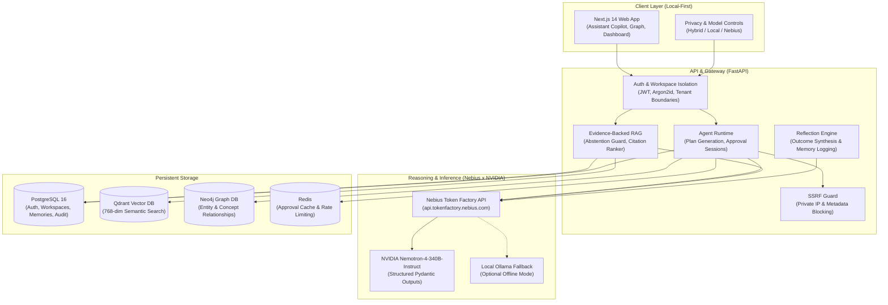

# SynapseOS

<p align="center">
  <strong>Privacy-First Personal AI Operating System</strong><br>
  <em>The AI That Remembers, Reasons, and Acts</em>
</p>

<p align="center">
  <a href="LICENSE"></a>
  
  
  
  
  
  
</p>

---

## 1. Project Vision & Purpose

**SynapseOS** is a privacy-conscious, local-first Personal AI Operating System that turns fragmented personal notes, documents, project tasks, and workspace interactions into an active, reasoning assistant.

The core promise is:
> **An AI that remembers, reasons, and acts — while keeping the user in full control of their data and actions.**

Unlike opaque cloud assistants that lock your knowledge in vendor silos, leak sensitive prompts, or hallucinate answers, SynapseOS combines:
1. **Persistent Multi-Modal Memory**: Relational, vector, and graph representations of your knowledge with full CRUD and deletion transparency across restarts.
2. **Multi-Format Document Ingestion**: Ingests `.md`, `.txt`, `.pdf`, `.json`, and `.csv` with recursive chunking, schema validation, and clear error notifications for scanned PDFs without OCR.
3. **Evidence-Backed RAG**: Grounded question answering with verifiable citations and a strict **abstention guard** (refusing to hallucinate when evidence is absent).
4. **NVIDIA Nemotron Reasoning via Nebius Token Factory**: Server-side structured planning using `nvidia/nemotron-4-340b-instruct` hosted on high-throughput Nebius GPU clusters.
5. **Bounded Agent Runtime with Human-in-the-Loop Safety**: Multi-step plan execution where consequential tools require explicit human approval before execution, with strict cross-user authorization enforcement.
6. **SSRF Guard & Deterministic Tool Execution**: Hardened tools preventing loopback, private RFC1918 subnets, and cloud metadata access.
7. **Controlled Reflection & Memory Evolution**: Synthesizes lessons from completed workflows into long-term memory without autonomously altering system permissions.
8. **Zero-Leakage Privacy Policy**: Local storage by default, client-side PII/secret redaction before external routing, and zero logging of raw user prompts.

---

## 2. Architecture



---

## 3. The Memory-to-Action Loop

SynapseOS prioritizes a dependable vertical slice called the **Memory-to-Action Loop**:

1. **User Prompt**: The user issues an intent (e.g., *"Create project Mobile Launch and research optimal offline embedding models"*).
2. **Context Retrieval**: SynapseOS retrieves semantic memories and knowledge-graph associations isolated to the current workspace.
3. **Nemotron Structured Plan**: NVIDIA Nemotron decomposes the goal into discrete steps with tool selections and schema-validated arguments.
4. **Safety & Consequential Gate**:
   - Safe tools (e.g., `search_knowledge`, `generate_plan`) execute automatically.
   - Consequential tools (e.g., `create_project`) generate an approval request and pause execution.
5. **Human Confirmation & Security Authorization**: The user inspects the plan in the web UI and explicitly approves or rejects the action. The backend verifies the approving user matches the initiating session owner.
6. **Execution & Verification**: Authorized tools execute with validated arguments; errors are captured gracefully.
7. **Controlled Reflection**: The Reflection Engine synthesizes the task outcome into an `observation` memory for future context retrieval.

---

## 4. Benchmark & Verification Results

SynapseOS includes a reproducible benchmark evaluation suite (`scripts/evaluate_rag_agent.py`) and live acceptance suite (`scripts/e2e_acceptance_test.py`):

| Metric | Measured Result | Status |
|:-------|:---------------:|:------:|
| **Semantic Retrieval Recall@K** | **100.0%** (6/6) | Verified |
| **Grounded Answer & Citation Rate** | **100.0%** (6/6) | Verified |
| **Abstention on Unsupported Facts** | **100.0%** (3/3) | Verified |
| **Safe Tool Auto-Execution Rate** | **100.0%** (1/1) | Verified |
| **Consequential Action Approval Gate** | **100.0%** (1/1) | Verified |
| **Consequential Rejection Guard** | **100.0%** (1/1) | Verified |
| **Reflection & Memory Generation** | **100.0%** | Verified |
| **Pytest Unit Test Suite** | **52 Passed, 1 Skipped** | Verified |
| **End-to-End Acceptance Steps** | **8 / 8 Passed** | Verified |
| **Full-Stack Integration Contracts** | **12 / 12 Verified** | Verified |
| **Frontend Production Build** | **14 / 14 Routes Clean** | Verified |

---

## 5. Getting Started

### Prerequisites
- Node.js 20+
- Python 3.12+
- Docker & Docker Compose (optional, standalone fallback mode supported)

### 1. Clone & Configure Environment
```bash
git clone https://github.com/ManyaS-Git/synapseos.git
cd synapseos
cp .env.example .env
```

### 2. Configure Nebius Token Factory (Optional Cloud Inference)
To use live NVIDIA Nemotron inference:
1. Sign in to Nebius Token Factory: [https://tokenfactory.nebius.com/](https://tokenfactory.nebius.com/)
2. Open profile menu -> **Top Up** -> Enter your promotional code before **31 December 2026** (grants 25 credit units).
3. Under **API Keys**, create a new key.
4. Add to `.env`:
   ```env
   NEBIUS_API_KEY="your_api_key_here"
   NEBIUS_BASE_URL="https://api.tokenfactory.nebius.com/v1/"
   NEBIUS_MODEL="nvidia/nemotron-4-340b-instruct"
   ```
5. Verify your provider connection:
   ```bash
   python scripts/verify_nebius_inference.py
   ```
*(If no API key is set, SynapseOS operates in deterministic offline simulation mode for local development and testing).*

### 3. Run Locally in Standalone Mode

**Backend (FastAPI):**
```bash
# In project root
.\.venv\Scripts\activate
uvicorn app.main:app --host 0.0.0.0 --port 8000 --reload --app-dir apps/api
```

**Frontend (Next.js 14):**
```bash
# In project root (new terminal)
npm run dev -w @synapseos/web
```

Open `http://localhost:3000` to access SynapseOS.

---

## 6. Verification & Testing Commands

```powershell
# Run the complete backend test suite (52 tests)
.\.venv\Scripts\pytest.exe apps/api/tests/

# Run the live 8-step end-to-end acceptance test
.\.venv\Scripts\python.exe scripts\e2e_acceptance_test.py

# Run the full-stack frontend/backend contract test suite (12 contracts)
.\.venv\Scripts\pytest.exe tests/integration/test_frontend_fullstack_contracts.py -v -s

# Run the expanded benchmark evaluation suite
.\.venv\Scripts\python.exe scripts\evaluate_rag_agent.py

# Verify Nebius Token Factory provider integration (simulated mode)
.\.venv\Scripts\python.exe scripts\verify_nebius_inference.py --allow-simulated

# Build Next.js production bundle
npm run build -w @synapseos/web
```

---

## 7. Service Endpoints

| Service | Address | Description |
|:--------|:--------|:------------|
| **Web UI** | `http://localhost:3000` | Assistant Copilot, Dashboard, Memory Graph |
| **API Server** | `http://localhost:8000` | FastAPI backend |
| **Interactive Docs** | `http://localhost:8000/docs` | OpenAPI / Swagger interactive documentation |
| **Health Check** | `http://localhost:8000/health` | Service and LLM connectivity status |
| **Document Ingestion** | `POST /api/v1/memory/upload` | Upload `.md`, `.txt`, `.pdf`, `.json`, `.csv` |
| **RAG Query Endpoint** | `POST /api/v1/rag/query` | Evidence-backed search with citations |
| **Agent Chat Endpoint** | `POST /api/v1/agent/chat` | Multi-step agent planning & execution |
| **Agent Approval Gate** | `POST /api/v1/agent/approve` | Human confirmation of consequential actions |

---

## 8. License

This project is licensed under the **Apache License 2.0**. See the [LICENSE](LICENSE) file for details.
