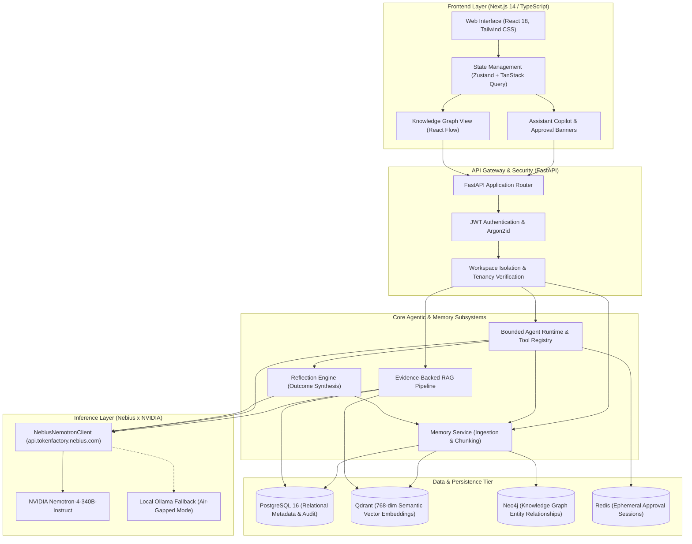

# SynapseOS System Architecture

**Version**: 0.2.0  
**Status**: Implemented & Tested  
**Target Track**: Personal AI Track (Nebius x NVIDIA Global AI Hackathon 2026)  

---

## 1. High-Level Architecture Overview

SynapseOS is engineered as a **resilient modular monolith** combining local-first persistence with high-throughput cloud reasoning:

---

## 2. Subsystem Breakdowns

### 2.1 Backend Architecture (`apps/api`)
Built with **FastAPI** and Python 3.12, following the **Repository & Service Pattern**:
- **`app/models/`**: SQLAlchemy declarative models (`User`, `Workspace`, `Project`, `Memory`, `MemoryTag`).
- **`app/repositories/`**: Isolated database access layers (`MemoryRepository`, `WorkspaceRepository`, `ProjectRepository`).
- **`app/services/`**: Domain logic (`MemoryService`, `EmbeddingService`, `VectorStore`, `GraphService`).
- **`app/routers/`**: Versioned REST endpoints (`/api/v1/auth`, `/api/v1/workspaces`, `/api/v1/projects`, `/api/v1/memory`, `/api/v1/agent`, `/api/v1/rag`).

### 2.2 Nebius Token Factory & NVIDIA Nemotron Engine (`app/core/llm/nebius.py`)
- Communicates server-side with `https://api.tokenfactory.nebius.com/v1/` using `httpx.AsyncClient`.
- Employs `nvidia/nemotron-4-340b-instruct` for complex multi-step reasoning and JSON plan generation.
- **Pydantic Structured Outputs**: Injects JSON schemas directly into system prompts and enforces strict validation against target models (`AgentPlan`, `ReflectionSummary`).
- **Resilience**: Features automatic JSON repair, configurable retry backoffs, and an offline deterministic simulation engine for CI and local unit test environments.

### 2.3 Evidence-Backed RAG Pipeline (`app/rag/pipeline.py`)
- **Query Embedding**: Computes a 768-dimensional normalized semantic vector.
- **Candidate Retrieval**: Fetches candidate chunks from vector storage with strict `workspace_id` filtering.
- **Authoritative Verification**: Validates that retrieved memories are currently `ACTIVE` in PostgreSQL.
- **Abstention Guard**: If the top similarity score is below the confidence threshold (`min_score=0.25`), the pipeline flags `is_unsupported=True` and returns a transparent refusal, preventing hallucinations.
- **Citations**: Returns structured citations referencing memory IDs, titles, and exact excerpts.

### 2.4 Bounded Agent Runtime & Safety Gates (`app/agents/runtime.py`)
- Interprets user instructions into an `AgentPlan`.
- Validates all tool arguments against Pydantic schemas.
- **Consequential Action Gates**: Consequential tools (e.g., `create_project`) are halted before execution. An ephemeral approval session is generated in `PENDING_SESSIONS`.
- Execution only proceeds when the user issues an authenticated `POST /api/v1/agent/approve` with `approved=True`.

### 2.5 Controlled Reflection Engine (`app/reflection/engine.py`)
- Analyzes completed tool steps and outcomes.
- Synthesizes high-level takeaways into a structured `ReflectionSummary`.
- Persists transparent `observation` memories to long-term memory for future context retrieval.
- Never alters application source code or security policies autonomously.

### 2.6 Frontend Web Application (`apps/web`)
Built on **Next.js 14 App Router**, TypeScript, and Tailwind CSS:
- **Assistant Copilot (`/assistant`)**: Conversational interface with interactive execution plan steps, approval banners, citation drawers, and reflection summaries.
- **Dashboard (`/dashboard`)**: System overview with live Nebius status indicators and direct navigation cards.
- **Knowledge Graph (`/memory/graph`)**: Interactive React Flow node and edge visualizer for interconnected memories.
- **Memory Management (`/memory`, `/memory/create`, `/memory/search`)**: Full CRUD operations, document upload (`.pdf`, `.md`, `.txt`), and semantic search.
- **Settings (`/settings`)**: Model routing (Hybrid / Local / Cloud) and privacy controls.
