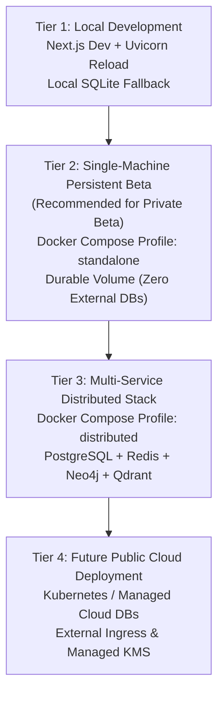

# SynapseOS Production Deployment Guide

**Release Version**: `0.4.0` (Private Beta)  
**Target Environments**: Windows PowerShell, Linux (Ubuntu/Debian), Docker Compose  

SynapseOS supports four distinct deployment tiers, from local development to production multi-service clusters.

---

## 1. Deployment Tiers



| Deployment Tier | Primary Target | Storage Mode | External Dependencies | When to Use |
|:----------------|:---------------|:-------------|:----------------------|:------------|
| **Tier 1: Local Development** | Workstation | `auto` | None (SQLite fallback) | Code changes, local debugging, fast iteration |
| **Tier 2: Single-Machine Persistent Beta** | Single VM or Bare-Metal | `local_embedded` | **Zero** (All data in persistent volume) | **Recommended for Private Beta evaluation** |
| **Tier 3: Multi-Service Stack** | High-capacity VM / Host | `distributed` | PostgreSQL 16, Redis 7, Neo4j 5, Qdrant 1.10 | High-throughput, multi-user enterprise deployments |
| **Tier 4: Public Cloud / K8s** | Managed Cloud (AWS/GCP/Azure) | `distributed` | Managed Cloud SQL, Memorystore/ElastiCache, Qdrant Cloud | Scaled horizontal production (planned) |

---

## 2. Environment Variables & Secret Handling

### Public Frontend Variables vs. Server-Only Secrets

> [!CAUTION]
> **Never set server secrets in `NEXT_PUBLIC_*` variables.** Variables prefixed with `NEXT_PUBLIC_` are statically baked into client-side JavaScript bundles and visible to any user who inspects the browser console.

| Variable | Scope | Required in Prod | Description | Default / Example |
|:---------|:------|:----------------:|:------------|:------------------|
| `APP_ENV` | Backend | **Yes** | Environment mode (`production`, `development`) | `production` |
| `APP_DEBUG` | Backend | **Yes** | Debug mode (must be `false` in production) | `false` |
| `APP_SECRET_KEY` | Backend (Secret) | **Yes** | Session & state encryption key ($\ge 16$ chars) | `openssl rand -hex 32` |
| `JWT_SECRET_KEY` | Backend (Secret) | **Yes** | Token signing secret ($\ge 16$ chars) | `openssl rand -hex 32` |
| `STORAGE_MODE` | Backend | **Yes** | `local_embedded`, `auto`, or `distributed` | `local_embedded` |
| `ENABLE_DOCS_IN_PRODUCTION` | Backend | No | Enables `/docs` and `/redoc` in production | `false` |
| `NEBIUS_API_KEY` | Backend (Secret) | Optional | Nebius Token Factory inference key | `your-key` (or empty for simulation) |
| `NEBIUS_BASE_URL` | Backend | No | OpenAI-compatible endpoint | `https://api.tokenfactory.nebius.com/v1` |
| `NEBIUS_MODEL` | Backend | No | NVIDIA Nemotron model ID | `nvidia/Llama-3.1-Nemotron-70B-Instruct-HF` |
| `PRIVACY_MODE` | Backend | No | Privacy boundary (`hybrid`, `local_only`) | `hybrid` |
| `NEXT_PUBLIC_CLERK_PUBLISHABLE_KEY` | **Frontend (Public)** | **Yes (Clerk)** | Clerk Publishable Key (`pk_...`) | `pk_live_your_clerk_key` |
| `CLERK_SECRET_KEY` | **Backend (Secret)** | **Yes (Clerk)** | Clerk Backend Secret Key (`sk_...`) | `sk_live_your_clerk_key` |
| `CLERK_JWT_KEY` | **Backend (Secret)** | Optional | Clerk PEM public key for local verification | `-----BEGIN PUBLIC KEY-----\n...` |
| `CLERK_ISSUER` | Backend | Optional | Clerk Issuer instance URL | `https://your-app.clerk.accounts.dev` |
| `NEXT_PUBLIC_API_URL` | **Frontend (Public)** | **Yes** | Base URL for API calls from browser | `http://localhost:8000` or `https://synapseos-api-2onj.onrender.com` |
| `NEXT_PUBLIC_WS_URL` | **Frontend (Public)** | No | WebSocket endpoint | `ws://localhost:8000/ws` |

### Generating Cryptographic Secrets

Generate 256-bit cryptographic secrets before launching:
```bash
# Linux / macOS
openssl rand -hex 32

# Windows PowerShell
-join ((1..32) | ForEach-Object { '{0:x2}' -f (Get-Random -Minimum 0 -Maximum 256) })
```

---

## 3. Tier 2: Single-Machine Persistent Beta Deployment (Recommended)

In this mode, SynapseOS operates as a self-contained, fully durable system using its embedded SQLite database, JSON vector index, and JSON knowledge graph store within a Docker persistent volume. **No secondary databases (Postgres, Redis, Neo4j, Qdrant) are needed.**

### Step 1: Configure Environment

Create `.env.production`:
```env
APP_ENV=production
APP_DEBUG=false
APP_SECRET_KEY=94f6c4b22031a0e19a9a3b68142ce144b611ff928f08082987a0209633e2dd55
JWT_SECRET_KEY=5f18c642732ce6f8099cb2be44f08c3bc05177242dfc221146747e7d953ccb41
APP_LOG_LEVEL=INFO
STORAGE_MODE=local_embedded
ENABLE_DOCS_IN_PRODUCTION=false

# Optional Nebius Inference (leave empty to use deterministic simulation mode)
NEBIUS_API_KEY=
PRIVACY_MODE=hybrid

# Frontend
NEXT_PUBLIC_API_URL=http://localhost:8000
```

### Step 2: Launch via Docker Compose (Standalone Profile)

#### Windows PowerShell:
```powershell
docker compose -f docker-compose.prod.yml --env-file .env.production --profile standalone up -d --build
```

#### Linux Bash:
```bash
docker compose -f docker-compose.prod.yml --env-file .env.production --profile standalone up -d --build
```

### Step 3: Verify Deployment Readiness

```bash
# Inspect container health
docker compose -f docker-compose.prod.yml ps

# Query readiness probe
curl -f http://localhost:8000/health/ready
```

Expected output:
```json
{
  "status": "ready",
  "environment": "production",
  "version": "0.4.0",
  "storage_mode": "local_embedded",
  "privacy_mode": "hybrid",
  "services": {
    "postgres": {"status": "healthy", "engine": "sqlite", "host": "local"},
    "redis": {"status": "unavailable"},
    "neo4j": {"status": "unavailable"},
    "qdrant": {"status": "unavailable"},
    "ollama": {"status": "unavailable"},
    "nebius_token_factory": {"status": "unconfigured"}
  }
}
```

---

## 4. Tier 3: Multi-Service Distributed Deployment

For enterprise environments requiring horizontal scaling, connection pooling, and multi-user load.

### Launch Commands
```bash
docker compose -f docker-compose.prod.yml --env-file .env.production --profile distributed up -d --build
```

Services launched:
- `api-distributed`: FastAPI production container (`STORAGE_MODE=distributed`)
- `web-distributed`: Next.js 14 production standalone bundle
- `postgres`: PostgreSQL 16 Alpine with healthcheck
- `redis`: Redis 7 Alpine with healthcheck
- `neo4j`: Neo4j 5 Community with healthcheck
- `qdrant`: Qdrant 1.10 with REST & gRPC endpoints

---

## 5. Tier 4: Future Public Cloud Deployment Blueprint

For deploying to Kubernetes (EKS / GKE / AKS) or managed container environments (AWS ECS / GCP Cloud Run):

1. **Database Decoupling**:
   - Replace containerized Postgres with managed RDS / Cloud SQL PostgreSQL 16 (enable automated backups, multi-AZ).
   - Replace Redis container with Amazon ElastiCache or GCP Cloud Memorystore.
   - Point Qdrant to Qdrant Cloud or a stateful StatefulSet on persistent NVMe SSDs.
2. **TLS Termination & Ingress**:
   - Ingress controller (e.g. AWS ALB Controller or NGINX Ingress) terminating TLS 1.3.
   - Map `api.yourdomain.com` to FastAPI and `app.yourdomain.com` to Next.js.
3. **Secrets Management**:
   - Mount `APP_SECRET_KEY`, `JWT_SECRET_KEY`, and `NEBIUS_API_KEY` via HashiCorp Vault or AWS Secrets Manager / GCP Secret Manager into container environment variables.
4. **Stateful Backups**:
   - Use `scripts/backup_restore.py` scheduled via a daily Kubernetes CronJob shipping archives to private S3/GCS buckets with Object Lock (WORM).

---

## 6. Rollback Procedure

If a deployment fails health checks or regressions are discovered:

1. **Stop active containers**:
   ```bash
   docker compose -f docker-compose.prod.yml down
   ```
2. **Restore previous stable data snapshot**:
   ```bash
   python scripts/backup_restore.py restore backups/safety_snapshots/synapseos_backup_YYYYMMDD_HHMMSS.tar.gz
   ```
3. **Rollback to previous image tag or commit**:
   ```bash
   git checkout <PREVIOUS_STABLE_TAG>
   docker compose -f docker-compose.prod.yml --profile standalone up -d
   ```
4. **Confirm health**:
   ```bash
   curl -f http://localhost:8000/health/ready
   ```
