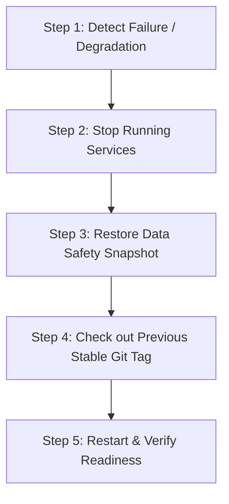

# SynapseOS Operations & SRE Runbook

**System**: SynapseOS — Memory-First Personal AI Operating System  
**Version**: `0.4.0` (Private Beta)  
**Classification**: Operational Procedures, Disaster Recovery & Incident Triage  

---

## 1. Daily Operations & Routine Maintenance

### 1.1 Service Health Probes
SynapseOS exposes three HTTP health check probes:

| Endpoint | Probe Type | Purpose | Expected Status |
|:---------|:-----------|:--------|:----------------|
| `GET /health/live` | Liveness | Verifies that the FastAPI process is responsive and event loop is healthy. | `200 OK` (`{"status": "alive"}`) |
| `GET /health` | Basic Health | Fast check for ingress load balancers. | `200 OK` (`{"status": "healthy"}`) |
| `GET /health/ready` | Readiness | Deep check verifying primary storage and downstream services. | `200 OK` (Ready) or `503` (Degraded) |

#### Triage Matrix for `/health/ready`:
- In **`STORAGE_MODE=local_embedded`** or **`STORAGE_MODE=auto`**:
  - `status: "ready"` (HTTP 200) indicates the primary SQLite database and local vector/graph persistence layers are healthy.
  - Downstream services (`redis`, `neo4j`, `qdrant`) reporting `"status": "unavailable"` is **normal and supported**.
- In **`STORAGE_MODE=distributed`**:
  - Requires all four services (`postgres`, `redis`, `neo4j`, `qdrant`) to report `"status": "healthy"`. If any is `"unhealthy"`, readiness returns `503 Service Unavailable`.

---

## 2. Backup, Recovery & Data Durability

All SynapseOS local state is persisted in the directory defined by `DATA_DIR` (defaults to `<repo_root>/data`):
- `synapseos_local.db`: SQLite database storing users, workspaces, projects, memories, and tags.
- `local_vector_store.json`: Persistent vector embeddings for semantic retrieval.
- `local_graph_store.json`: Knowledge graph nodes and semantic relationship edges.
- `approval_sessions.json`: Durable state for pending and finalized consequential agent actions.

### 2.1 Scheduled Backup Procedure
Run the automated backup engine. Backups produce a `.tar.gz` archive containing a SHA-256 verified `manifest.json`.

#### Windows PowerShell:
```powershell
.venv\Scripts\python.exe scripts\backup_restore.py backup --output-dir backups\
```

#### Linux Bash:
```bash
python3 scripts/backup_restore.py backup --output-dir backups/
```

### 2.2 Verifying Archive Integrity
Before performing maintenance or archiving, verify the SHA-256 checksums:
```bash
python scripts/backup_restore.py verify backups/synapseos_backup_20261022_120000.tar.gz
```

### 2.3 Disaster Recovery / Restore Procedure
To restore the system from a backup archive:
```bash
# Performs validation, creates an automatic pre-restore safety snapshot, and restores files:
python scripts/backup_restore.py restore backups/synapseos_backup_20261022_120000.tar.gz
```

> [!NOTE]
> `restore_backup` automatically takes a safety snapshot of existing active data in `backups/safety_snapshots/` before unpacking. Existing data is never overwritten without a fallback snapshot.

---

## 3. Live AI Provider (Nebius Token Factory) Procedure

SynapseOS defaults to a deterministic, high-fidelity offline simulation fallback if no live Nebius credentials are configured. This prevents automated tests and local runs from failing or incurring costs.

### 3.1 Activating Live Nebius Inference (Minimal Manual Steps)
1. **Log in to Nebius Token Factory**: Navigate to [https://tokenfactory.nebius.com/](https://tokenfactory.nebius.com/).
2. **Redeem Promotional Credits**: Open your account profile, select **Top Up / Redeem**, and apply your promotional code to establish your balance.
3. **Generate API Key**: Go to **API Keys**, generate a new key, and copy it safely.
4. **Configure Local Environment**: Add your key to your `.env` or `.env.production` file:
   ```env
   NEBIUS_API_KEY="your-actual-api-key"
   NEBIUS_MODEL="nvidia/Llama-3.1-Nemotron-70B-Instruct-HF"
   PRIVACY_MODE="hybrid"
   ```
5. **Run the Live Verification Script**:
   ```powershell
   .venv\Scripts\python.exe scripts\verify_nebius_inference.py
   ```

### 3.2 Interpreting Verification Script Exit Codes

| Status Text | Exit Code | Interpretation | Action Required |
|:------------|:---------:|:---------------|:----------------|
| `LIVE_PROVIDER_VERIFIED` | `0` | Live HTTPS roundtrip to Nebius succeeded with real model response. | None. Live inference operational. |
| `SIMULATION_VERIFIED` | `0` | Script run with `--allow-simulated`. Offline simulation validated. | Notice: Confirms simulation only, not live provider. |
| `BLOCKED` | `2` | Credentials missing, placeholder value, or auth failure (401/403). | Configure `NEBIUS_API_KEY` in `.env`. |
| `FAILED` | `1` | Network timeout, model 404, or API quota error. | Check account balance or increase timeout. |

---

## 4. Observability & Log Analysis

### 4.1 Request Correlation
Every incoming HTTP request is tagged with an `X-Request-ID`.
- If client sends `X-Request-ID`, it is preserved.
- If omitted, the middleware generates `req-<hex12>` and returns it in the response headers.
- All internal logs during that request lifetime bind `request_id=<id>`.
- Any unhandled exception (HTTP 500) returns `{"detail": "Internal server error", "status": 500, "request_id": "req-..."}` to the client without exposing Python stack traces.

### 4.2 Searching Logs
```bash
# Find all entries for a specific request ID:
grep "req-a1b2c3d4e5f6" logs/synapseos.log

# Monitor AI model latency and token counts:
grep "synapseos.llm.telemetry" logs/synapseos.log
```

---

## 5. Security & Incident Response

### 5.1 Credential Rotation Procedure
If `APP_SECRET_KEY` or `JWT_SECRET_KEY` is compromised:
1. Generate new 256-bit secrets:
   ```bash
   openssl rand -hex 32
   ```
2. Update `.env.production` with the new values.
3. Restart the API:
   ```bash
   docker compose -f docker-compose.prod.yml --profile standalone restart api-standalone
   ```
4. *Impact*: Active user JWT sessions will be invalidated; users must re-authenticate. Stored passwords remain secure under Argon2id salt.

### 5.2 Consequential Agent Action Auditing
To audit actions awaiting human approval:
- Inspect `data/approval_sessions.json`.
- Each session records: `session_id`, `user_id`, `workspace_id`, `goal`, `plan`, `created_at`, `expires_at`, and `status`.
- Expired sessions ($\text{TTL} > 15 \text{ min}$) are automatically rejected by `ApprovalStore`.

---

## 6. Rollback Playbook

When an operational release failure occurs:



1. **Stop active services**:
   ```bash
   docker compose -f docker-compose.prod.yml down
   ```
2. **Restore most recent safety snapshot**:
   ```bash
   python scripts/backup_restore.py restore backups/safety_snapshots/synapseos_backup_LATEST.tar.gz
   ```
3. **Re-deploy previous stable tag**:
   ```bash
   git checkout tags/v0.3.0
   docker compose -f docker-compose.prod.yml --profile standalone up -d --build
   ```
4. **Validate system readiness**:
   ```bash
   curl -f http://localhost:8000/health/ready
   ```
